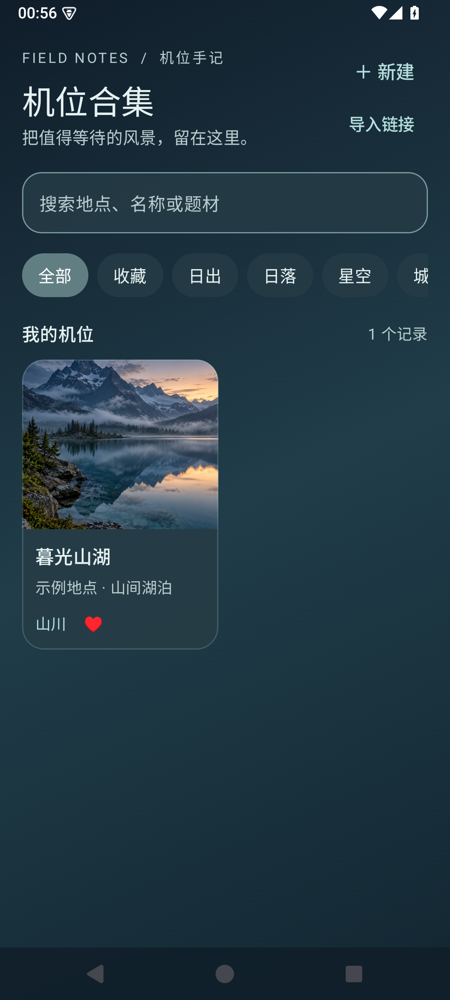
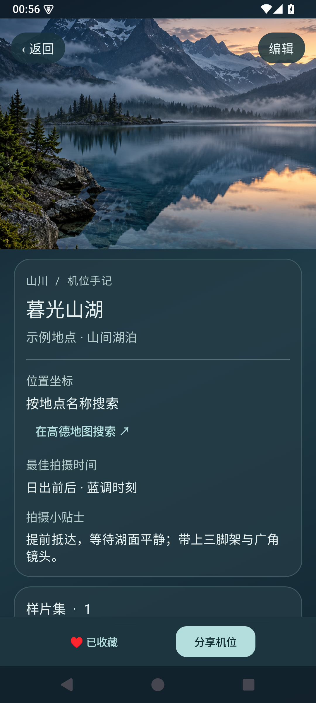
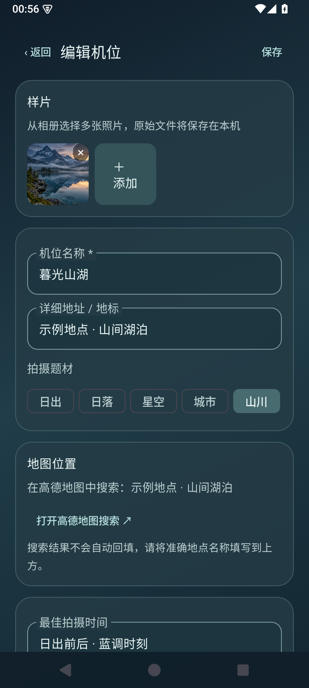

# Vistake · 机位合集

**把值得等待的风景，留在这里。**

Vistake 是一款面向风光摄影爱好者的 Android 机位收藏工具。把地点、拍摄时段、现场提示和样片整理在一起，让下一次出发更从容。

<p align="center"></p>

## 界面预览

以下画面来自 Android 模拟器，地点为虚构演示内容，样片由 AI 生成。

<p align="center">
  
  
  
</p>

## 已有功能

- **机位整理**：新建、编辑、删除机位，记录地点、拍摄题材、最佳时间与拍摄提示。
- **样片收藏**：通过系统照片选择器批量导入图片，在机位详情浏览多张样片。
- **快速查找**：按名称、地点、题材搜索，并通过题材筛选和收藏整理机位。
- **文字链接分享与导入**：复制或分享机位链接；接收方使用 Vistake 预览并导入为自己的本地记录。
- **高德地图搜索**：根据填写的地点名称打开手机高德地图搜索。
- **视觉体验**：深色渐变与半透明玻璃风格、图标联动开场、轻量页面切换动画。

## 当前版本说明

这是本地预览版，功能仍在完善：

- 机位和图片存储在设备的应用私有空间，卸载应用会删除数据；暂不支持账号、同步或备份导出。
- 分享链接是自包含的应用链接，包含文字和已有坐标，**不包含样片**；接收方需要安装本应用。部分聊天软件不会识别该链接，可复制后从首页粘贴导入。链接内容可由持有者读取。
- 高德地图搜索不会自动回填选点和坐标。暂不支持在线机位库、公开网页预览、点赞及热门排序。
- 玻璃效果由半透明层实现，尚未实现背景实时虚化；照片移除后，应用内已复制的文件暂不会自动清理。

## 开发与运行

- Kotlin、Jetpack Compose、Material 3、Coil
- Android 8.0（API 26）及以上
- Android SDK Platform 37、JDK 17 或更高版本

1. 使用 Android Studio 打开本仓库，安装所需的 Android SDK，等待 Gradle 同步。
2. 选择 Android 设备或模拟器，运行 `app` 配置。
3. 命令行构建调试版：

   ```bash
   ./gradlew assembleDebug
   ```

   Windows PowerShell 使用 `./gradlew.bat assembleDebug`。构建输出位于 `app/build/outputs/apk/debug/app-debug.apk`。

Gradle 使用仓库中的 wrapper；`local.properties` 由 Android Studio 在本机生成，不应提交。

